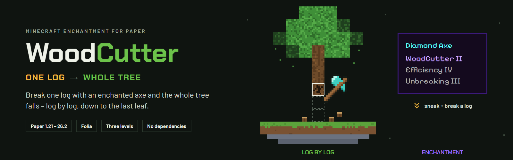
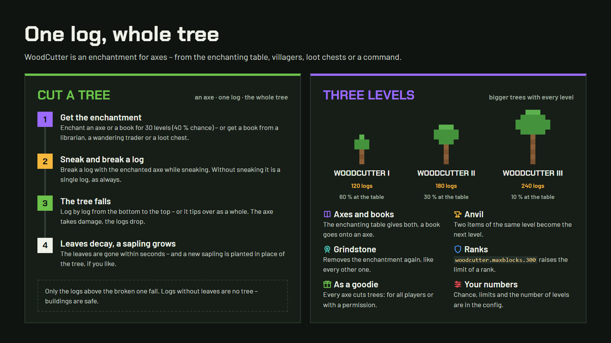
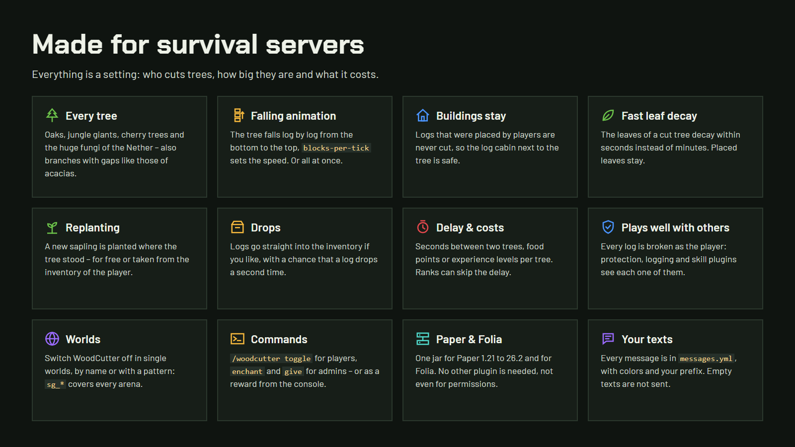
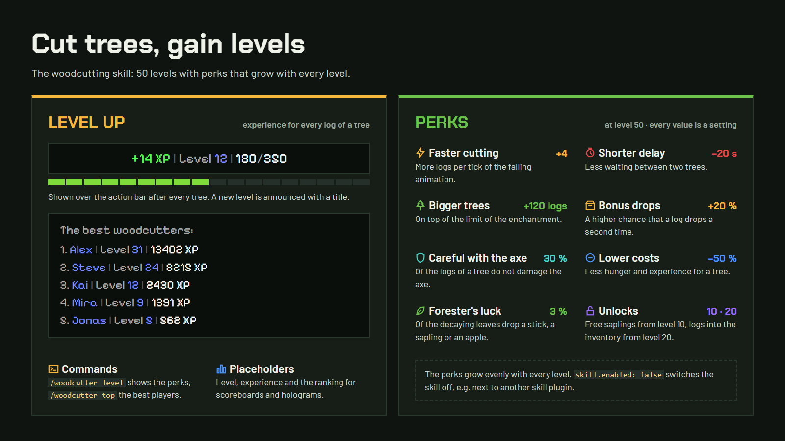

# WoodCutter

**WoodCutter** adds an enchantment for axes that cuts the whole tree when you break one log – with levels, a falling
animation, a woodcutting skill and a lot of settings. No commands are needed to play: sneak, break a log, done.

**Requirements:** Paper or Folia 1.21 or newer, Java 21. Spigot is not supported.

**Download:** [GitHub](https://github.com/itsthechris07/WoodCutter/releases/latest) ·
[Modrinth](https://modrinth.com/plugin/woodcutter-christian34) ·
[SpigotMC](https://www.spigotmc.org/resources/58193/)



## The enchantment

- **Enchanting table:** axes and books get WoodCutter with an offer of level 30 (40 % chance by default).
- **Levels:** WoodCutter I, II and III – higher levels cut bigger trees (120 / 180 / 240 logs by default).
- **Anvil:** two items of the same level are combined to the next level, a book puts the enchantment onto an axe.
- **Grindstone:** removes the enchantment.
- **More sources:** librarians and wandering traders sell books with WoodCutter, and chests with loot contain them.
- **Goodie:** optionally players cut trees with every axe, without the enchantment – all of them or by permission.



## Cutting trees

- **Every tree:** all logs of the game, including cherry, mangrove and the huge fungi of the Nether. Huge mushrooms
  are cut as well.
- **Animations:** the tree falls log by log from the bottom to the top, or tips over away from the player.
- **Buildings are safe:** logs placed by players are never cut, and logs without leaves are no tree.
- **Fast leaf decay**, **replanting** (four saplings for big trees), **drops into the inventory**, **bonus drops**
  and **experience drops**.
- **Axe protection:** cutting stops before the hit that would break the axe.
- **Costs and delay:** a tree can cost food points or experience levels, and a delay between two trees keeps it fair.
- **Other plugins:** every log is broken as the player, so protection, logging and skill plugins handle each log.



## Woodcutting skill

Players gain experience for every log of a tree they cut and reach levels (50 by default). The perks grow with every
level: faster cutting, a shorter delay, bigger trees, bonus drops, less damage for the axe, lower costs and
forester's luck (leaves drop sticks, saplings or apples). Free replanting and drops into the inventory are unlocked
at levels 10 and 20. All values can be changed, and the skill can be switched off.

## Commands

| Command | Description | Permission |
|---|---|---|
| `/woodcutter menu` | Menu: switch WoodCutter on and off, level, perks and the best players – admins change settings there | – |
| `/woodcutter toggle` | Switch WoodCutter on or off for yourself | `woodcutter.use` |
| `/woodcutter level [player]` | Woodcutting level and perks | – |
| `/woodcutter top` | The best woodcutters | – |
| `/woodcutter give <player> [book\|axe] [level]` | Give an enchanted book or axe (also from the console) | `woodcutter.admin` |
| `/woodcutter enchant [level]` | Enchant the axe in the main hand | `woodcutter.admin` |
| `/woodcutter reload` | Reload the files | `woodcutter.admin` |

Aliases: `/wcutter`, `/woodc`

## Permissions

| Permission | Description | Default |
|---|---|---|
| `woodcutter.use` | Get the enchantment at the enchanting table and cut trees with it | everyone |
| `woodcutter.goodie` | Cut trees with every axe (with `goodie: permission`) | – |
| `woodcutter.bypass.delay` | No delay between two trees | – |
| `woodcutter.delay.<seconds>` | A shorter delay, e.g. for ranks | – |
| `woodcutter.maxblocks.<amount>` | A higher limit of logs, e.g. for ranks | – |
| `woodcutter.admin` | Reload, enchant, give and the settings in the menu | operators |

## Server

- **Folia** is supported, with the same jar.
- **WorldGuard** (optional): the region flag `woodcutter` – `/rg flag <region> woodcutter deny` disables WoodCutter
  in a region.
- **PlaceholderAPI** (optional): `%woodcutter_enabled%`, `%woodcutter_level%`, `%woodcutter_max_blocks%`,
  `%woodcutter_delay%`, `%woodcutter_skill_level%`, `%woodcutter_skill_xp%`, `%woodcutter_skill_xp_needed%` and
  `%woodcutter_top_<rank>_name%`, `..._level%`, `..._xp%` for the ranking.
- **Languages:** English and German (`language: de`), all texts can be changed in the `messages.yml`.
- **Disabled worlds** with patterns: `sg_*` matches `sg_1`, `sg_lobby`, …
- The config is updated automatically: new settings are added with their comments, your values stay.
- Anonymous statistics are sent to [bStats](https://bstats.org/plugin/bukkit/WoodCutter/3789), which can be disabled
  in `plugins/bStats/config.yml`.

## Building

```bash
./gradlew build
```

A JDK 25 is required to build, the jar runs on Java 21 and is written to `release/`.

## License

WoodCutter is licensed under the [Apache License 2.0](LICENSE). Bugs and ideas are welcome in the
[issues](https://github.com/itsthechris07/WoodCutter/issues).
