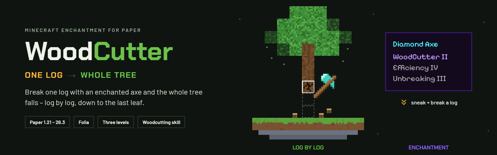
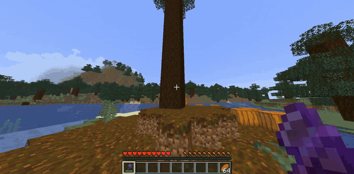
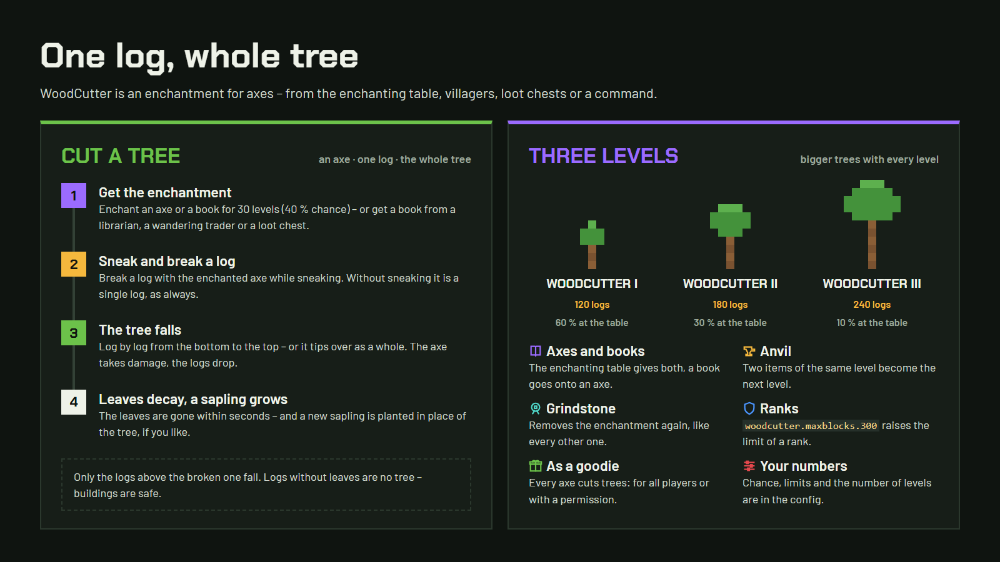
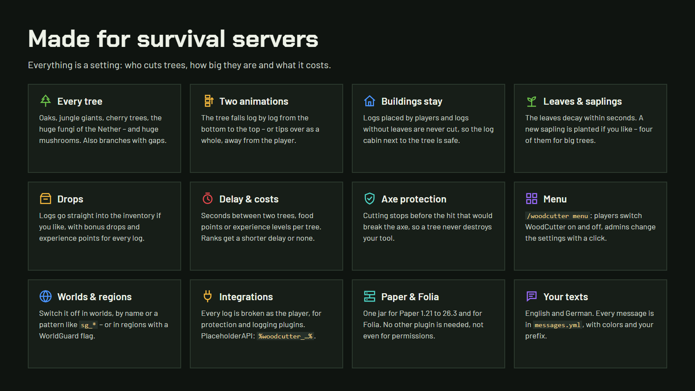
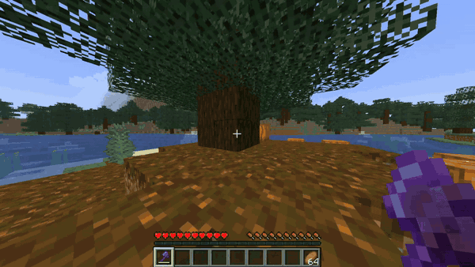
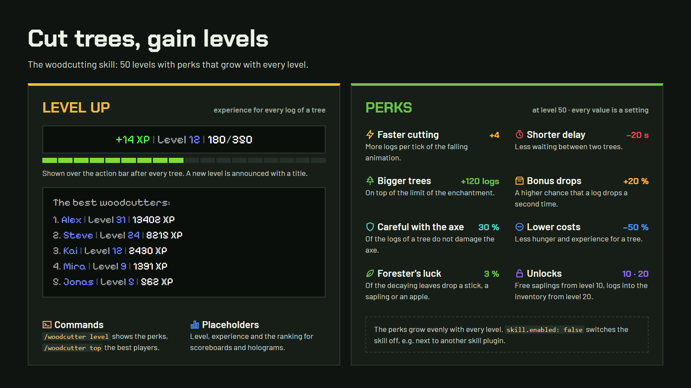

# WoodCutter

**WoodCutter** adds an enchantment for axes that cuts the whole tree when you break one log. It comes with levels, a falling
animation, a woodcutting skill and a lot of settings. No commands are needed to play: sneak, break a log, done.

**Requirements:** Paper or Folia 1.21 or newer (tested with 1.21.11, 26.2 and 26.3), Java 21 or newer. Spigot runs
with the same jar, with basic support; Paper is recommended.

**Download:** [GitHub](https://github.com/itsthechris07/WoodCutter/releases/latest) ·
[Modrinth](https://modrinth.com/plugin/woodcutter-christian34) ·
[SpigotMC](https://www.spigotmc.org/resources/58193/) ·
[Hangar](https://hangar.papermc.io/Christian34/WoodCutterPlus)

**Documentation:** every setting, command, permission and placeholder: **[https://itsthechris07.github.io/WoodCutter/](https://itsthechris07.github.io/WoodCutter/)**





## The enchantment

- **Enchanting table:** axes and books get WoodCutter with an offer of level 30 (40 % chance by default).
- **Levels:** WoodCutter I, II and III; higher levels cut bigger trees (120 / 180 / 240 logs by default).
- **Anvil:** two items of the same level are combined to the next level, a book puts the enchantment onto an axe.
- **Grindstone:** removes the enchantment.
- **More sources:** librarians and wandering traders sell books with WoodCutter, and chests with loot contain them.
- **Goodie:** optionally players cut trees with every axe, without the enchantment, either all of them or by permission.



## Cutting trees

- **Every tree:** all logs of the game, including cherry, mangrove and the huge fungi of the Nether. Huge mushrooms
  are cut as well.
- **Animations:** the tree falls log by log from the bottom to the top, or tips over with its leaves, with physics:
  it bounces, comes to rest on slopes, walls and other trees, floats on water or breaks apart. It falls away from
  the player, where they look, down the hill or at random. The items drop where it hits the ground, and mobs in the
  way are pushed away. No resource pack or mod is needed.
- **Sounds, particles and glow** can be changed or switched off, sounds of resource packs work as well.
- **Chopping:** bigger trees can take longer to chop, with the progress in a boss bar or the action bar.
- **Buildings are safe:** logs placed by players are never cut, and logs without leaves are no tree.
- **Cocoa, vines and bee nests** fall with the tree, and the bees attack the player who cut it.
- **Fast leaf decay**, **replanting** (four saplings for big trees, next to the stump if something is on it, and
  protected until they grow if you like), **drops into the inventory**, **bonus drops** and **experience drops**.
- **Custom blocks and axes:** logs, leaves and saplings of mods, and axes of ItemsAdder, Nexo, Oraxen and MMOItems.
- **Axe protection:** cutting stops before the hit that would break the axe.
- **Costs and delay:** a tree can cost food points, experience levels or money (Vault), and a delay between two
  trees keeps it fair. Trees can also earn money.
- **Other plugins:** every log is broken as the player, so protection, logging and skill plugins handle each log.





## Woodcutting skill

Players gain experience for every log of a tree they cut and reach levels (50 by default). The perks grow with every
level: faster cutting, a shorter delay, bigger trees, bonus drops, less damage for the axe, lower costs and
forester's luck (leaves drop sticks, saplings or apples). Free replanting and drops into the inventory are unlocked
at levels 10 and 20. Commands can reward levels, e.g. items or a rank. All values can be changed, and the skill can
be switched off.

## Commands

| Command | Description | Permission |
|---|---|---|
| `/woodcutter menu` | Menu: switch WoodCutter on and off, level, perks and the best players. Admins change settings there | none |
| `/woodcutter toggle` | Switch WoodCutter on or off for yourself | `woodcutter.use` |
| `/woodcutter level [player]` | Woodcutting level and perks | none |
| `/woodcutter top` | The best woodcutters | none |
| `/woodcutter give <player> [book\|axe] [level]` | Give an enchanted book or axe (also from the console) | `woodcutter.admin` |
| `/woodcutter enchant [level]` | Enchant the axe in the main hand | `woodcutter.admin` |
| `/woodcutter reload` | Reload the files | `woodcutter.admin` |

Aliases: `/wcutter`, `/woodc`

## Permissions

| Permission | Description | Default |
|---|---|---|
| `woodcutter.use` | Get the enchantment at the enchanting table and cut trees with it | everyone |
| `woodcutter.goodie` | Cut trees with every axe (with `goodie: permission`) | nobody |
| `woodcutter.bypass.delay` | No delay between two trees | nobody |
| `woodcutter.delay.<seconds>` | A shorter delay, e.g. for ranks | nobody |
| `woodcutter.maxblocks.<amount>` | A higher limit of logs, e.g. for ranks | nobody |
| `woodcutter.replant.break` | Break saplings WoodCutter has planted (with `replant.protect: true`) | operators |
| `woodcutter.admin` | Reload, enchant, give and the settings in the menu | operators |

## Server

- **Versions:** one jar for Paper 1.21 up to 26.3; the tests run on 1.21.11, 26.2 and 26.3.
- **Spigot** gets basic support with the same jar. Paper is recommended, and bugs that only happen on Spigot have a
  low priority.
- **Folia** is supported, with the same jar.
- **WorldGuard** (optional): the region flag `woodcutter` (`/rg flag <region> woodcutter deny` disables WoodCutter
  in a region), or a blacklist or whitelist of regions in the config.
- **ItemsAdder, Nexo, Oraxen, MMOItems** (optional): their items can be axes for WoodCutter.
- **PlaceholderAPI** (optional): `%woodcutter_enabled%`, `%woodcutter_level%`, `%woodcutter_max_blocks%`,
  `%woodcutter_delay%`, `%woodcutter_skill_level%`, `%woodcutter_skill_xp%`, `%woodcutter_skill_xp_needed%` and
  `%woodcutter_trees%` and `%woodcutter_top_<rank>_name%`, `..._level%`, `..._xp%`, `..._trees%` for the ranking.
- **Vault** (optional): money for cut trees and trees that cost money, with EssentialsX, CMI or another economy.
- **Languages:** English, German, French, Spanish, Polish, Chinese, Russian, Ukrainian, Czech and Portuguese
  (`language: de`, …). All texts can be changed,
  with color codes, hex colors (`&#ff8800`) or MiniMessage.
- **Disabled worlds** with patterns: `sg_*` matches `sg_1`, `sg_lobby`, …
- The config is updated automatically: new settings are added with their comments, your values stay.
- Anonymous statistics are sent to [bStats](https://bstats.org/plugin/bukkit/WoodCutter/3789), which can be disabled
  in `plugins/bStats/config.yml`.

## Documentation

Every setting, command, permission and placeholder: [the WoodCutter docs](https://itsthechris07.github.io/WoodCutter/).

## Building

```bash
./gradlew build
```

A JDK 25 is required to build, the jar runs on Java 21 and is written to `release/`. `./gradlew check` runs the tests
on Paper 26.2 and also on 1.21.11 (`test121`) and 26.3 (`test263`).

## License

WoodCutter is licensed under the [Apache License 2.0](LICENSE). Bugs and ideas are welcome in the
[issues](https://github.com/itsthechris07/WoodCutter/issues).
