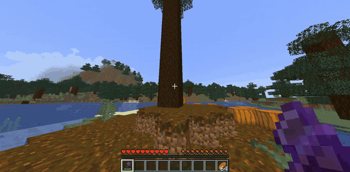
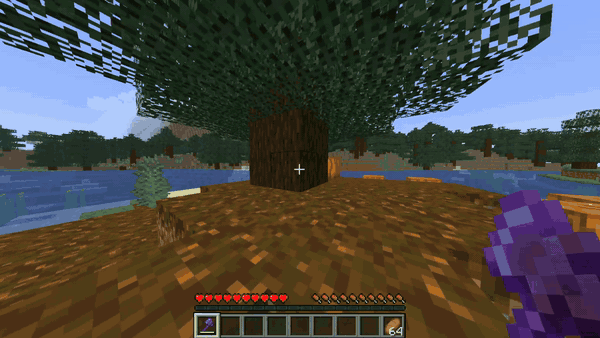

# Listing texts

Texts for the plugin pages on SpigotMC, Modrinth and Hangar. Most people search for "timber" or "treefeller", not for
"WoodCutter" – these words belong into the summary and the tags.

## Summary

Modrinth summary / Hangar description (max. 256 characters):

> Timber / tree feller enchantment for Paper & Folia: sneak, break one log and the whole tree falls. Levels, falling
> animation, replanting, a woodcutting skill with perks and an in-game menu. 1.21 – 26.3.

SpigotMC tag line (max. 100 characters):

> Timber enchantment: cut whole trees with one log – levels, animation, replanting, skill. Paper 1.21+

## Tags

- **Modrinth categories:** Game Mechanics, Equipment, Utility – loaders: Paper, Folia
- **Modrinth / Hangar keywords:** timber, treefeller, tree feller, tree capitator, lumberjack, woodcutting, axe,
  enchantment, skill, replant
- **Hangar category:** Gameplay – platform Paper 1.21 – 26.3
- **SpigotMC category:** Mechanics – "Tested Minecraft Versions": 1.21, 26.x

## Compatibility block

For the top of the description, right below the banner:

> **Paper & Folia 1.21 – 26.3** · Java 21+ · one jar for all versions · Spigot is not supported
>
> Works with WorldGuard (region flag), PlaceholderAPI, CoreProtect and every protection plugin – each log is broken
> as the player.

## Changelog 3.2.0

> - Animation 'topple': the tree falls with its leaves, the items drop where it hits the ground, and mobs and players
>   in the way are pushed away (optional damage). "Timber!" is shown as a subtitle.
> - Vault: trees can earn money per log and cost money.
> - Commands as rewards for levels of the woodcutting skill, e.g. items or a rank.
> - Trees cut per player: `/woodcutter level`, `%woodcutter_trees%`, `%woodcutter_top_<rank>_trees%`.
> - `excluded-logs`: logs that are never cut, e.g. `stripped_*`.
> - Fixed: trees standing diagonally next to the cut tree were cut as well.
> - Levels need more experience by default (new installations; existing configs keep their values).
> - MiniMessage and hex colors in all texts; French, Spanish, Polish and Chinese.
> - Documentation of every setting: https://github.com/itsthechris07/WoodCutter/tree/main/docs
> - Tested on Paper 1.21.11, 26.2 and 26.3.

## Images

`banner.png` at the top, then `how-it-works.png`, `features.png` and `skill.png` – see [README.md](README.md).

**Not on Modrinth:** these images were made with AI (Claude Design), which Modrinth's content rules (6.2a) forbid for
the icon, the description and the gallery. The Modrinth description (`release-notes/description.md`, local only)
embeds the recordings of `media/` from its own gallery (cdn.modrinth.com).

**GIFs on SpigotMC and Hangar**, right below the banner and below the list "Cutting trees":

SpigotMC (BBCode):

```
[IMG]https://raw.githubusercontent.com/itsthechris07/WoodCutter/main/branding/media/tree-falling.gif[/IMG]
[IMG]https://raw.githubusercontent.com/itsthechris07/WoodCutter/main/branding/media/leaves-and-saplings.gif[/IMG]
```

Hangar (Markdown):

```


```
