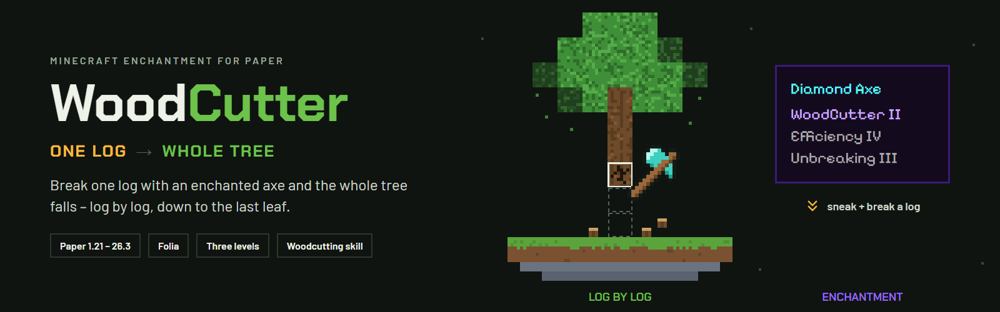
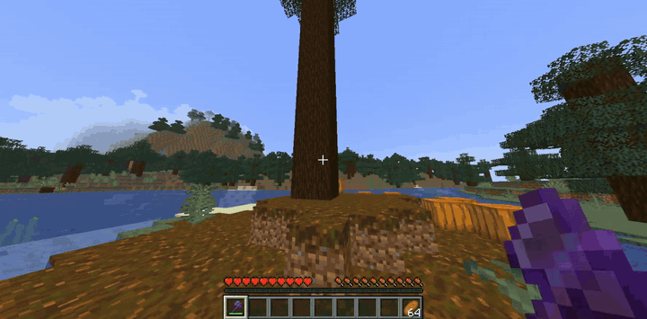

---
hide:
  - navigation
  - toc
---

# WoodCutter

{ .wc-banner }

WoodCutter adds an enchantment for axes. When a player breaks one log with it, the whole tree is cut. It comes with
levels, two animations, a woodcutting skill and many settings. To play, no commands are needed: sneak and break a log.

[:material-download: Download](https://github.com/itsthechris07/WoodCutter/releases/latest){ .md-button .md-button--primary }
[:material-rocket-launch: Getting started](getting-started.md){ .md-button }

!!! info "Requirements"
    Paper or Folia 1.21 or newer (tested on 1.21.11, 26.2 and 26.3) and Java 21 or newer. Spigot gets basic support,
    Paper is recommended.

    **Download:** [GitHub](https://github.com/itsthechris07/WoodCutter/releases/latest) ·
    [Modrinth](https://modrinth.com/plugin/woodcutter-christian34) ·
    [SpigotMC](https://www.spigotmc.org/resources/58193/) ·
    [Hangar](https://hangar.papermc.io/Christian34/WoodCutterPlus)

{ .wc-shot loading=lazy }

## Pages

-   :material-rocket-launch:{ .lg .middle } **[Getting started](getting-started.md)**

    ---

    Installing the plugin and the first tree

-   :material-cog:{ .lg .middle } **[Configuration](configuration.md)**

    ---

    Every setting of the `config.yml`

-   :material-console:{ .lg .middle } **[Commands & permissions](commands-and-permissions.md)**

    ---

    `/woodcutter` and the permissions for ranks

-   :material-axe:{ .lg .middle } **[Woodcutting skill](skill.md)**

    ---

    Levels, perks and rewards

-   :material-translate:{ .lg .middle } **[Messages & languages](messages.md)**

    ---

    Colors, MiniMessage and the translations

-   :material-code-braces:{ .lg .middle } **[Placeholders](placeholders.md)**

    ---

    PlaceholderAPI, for scoreboards and holograms

-   :material-puzzle:{ .lg .middle } **[Integrations](integrations.md)**

    ---

    WorldGuard, Vault, Jobs, mcMMO, AuraSkills, CoreProtect and the developer API

-   :material-help-circle:{ .lg .middle } **[FAQ](faq.md)**

    ---

    Nothing happens? Only some logs are cut?

## Help

Found a bug or have an idea? Open an [issue on GitHub](https://github.com/itsthechris07/WoodCutter/issues).
